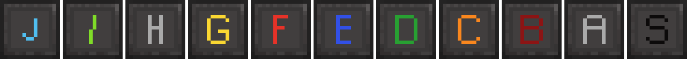

# Weigh Me

Hi! This is a small NeoForge mod that adds weights for Sable. I needed something
to balance my physics builds with, so I made these blocks. Maybe they'll be
useful to you too.

The code is open, so feel free to look around, learn from it or use it in your
worlds and modpacks. If something breaks or you have an idea, just open an
issue. Pull requests are welcome as well.

## What's inside

There are 11 weights, from 0.25 to 256. Each one has its own mass in Sable,
so adding them actually changes how your build moves. The letter on the block
shows which weight it is, and from time to time it lights up in its colour.

| Letter | Mass | Colour     |
|:------:|-----:|------------|
| J      | 0.25 | light blue |
| I      | 0.5  | lime       |
| H      | 1    | grey       |
| G      | 2    | yellow     |
| F      | 4    | red        |
| E      | 8    | blue       |
| D      | 16   | green      |
| C      | 32   | orange     |
| B      | 64   | dark red   |
| A      | 128  | grey       |
| S      | 256  | black      |

The smallest weight is made from an iron ingot in a stonecutter. Put two
weights of the same size together and you get the next one.

If you have Create installed, you can pick a weight up with the wrench
(Shift + right click).

The mod is translated into English, Russian, Spanish and German.

## What you need

- Minecraft 1.21.1
- NeoForge 21.1.250 or newer
- Sable 2.0.6 or newer
- Create, if you want to use the wrench (not required)

## Building it yourself

Run `./gradlew build` (or `gradlew.bat build` on Windows). The jar will be in
`build/libs`.

## License

The mod is under GPL-3.0 with a few extra terms. You'll find them in
[LICENSE](LICENSE) and [NOTICE.md](NOTICE.md).

Basically: download it, play with it, take it apart and change it however you
want. If you share a changed version, share its code too, mention the original
project and give your version a different name. Please don't pass it off as
your own.

---

## По-русски

Привет! Это небольшой мод для NeoForge, который добавляет гири для Sable.
Мне нужно было чем-то балансировать свои физические постройки, вот я их и
сделал. Может, и вам пригодятся.

Код открыт, так что смотрите, изучайте, используйте в своих мирах и сборках.
Если что-то сломалось или есть идея, пишите в issues. Pull request'ам тоже
буду рад.

Про лицензию коротко: скачивать, играть, разбирать и менять под себя можно.
Если выкладываете свою версию, выложите и её код, упомяните оригинальный
проект и назовите её по-другому. И, пожалуйста, не выдавайте мод за свой.
